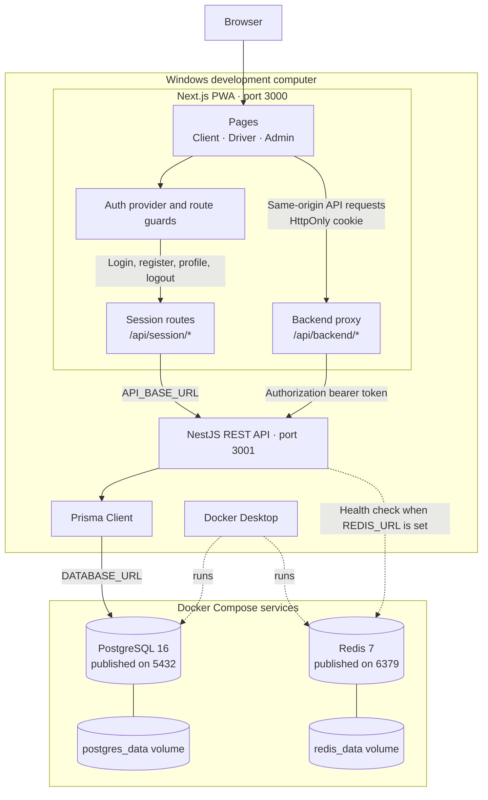
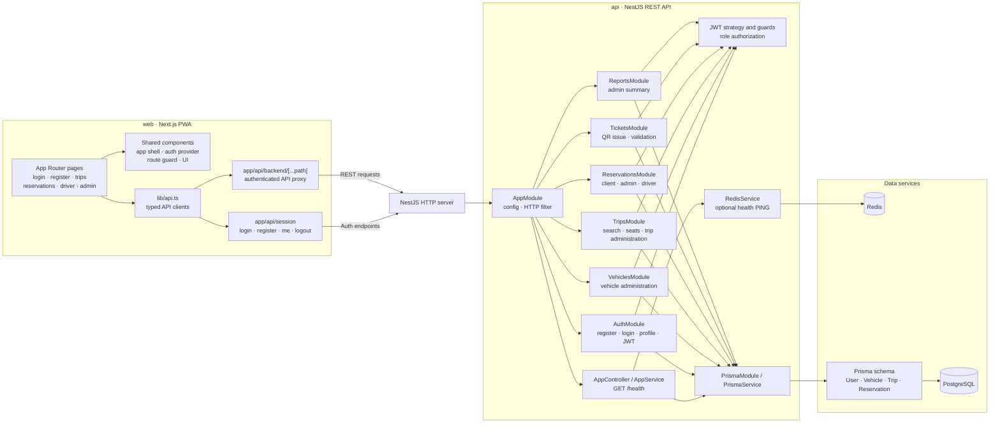
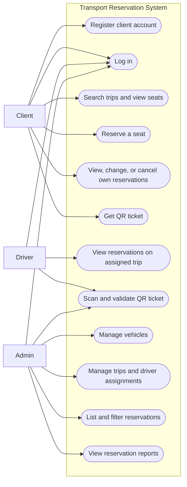
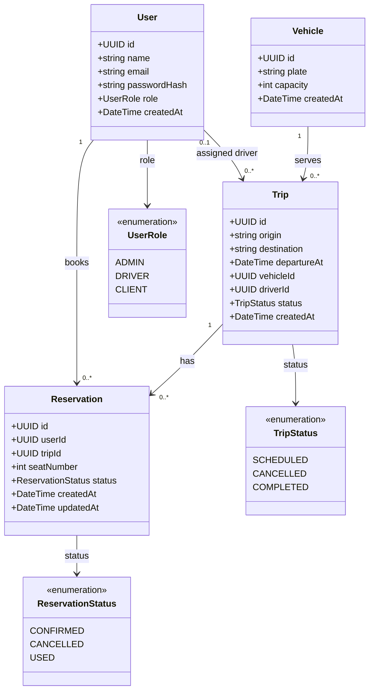
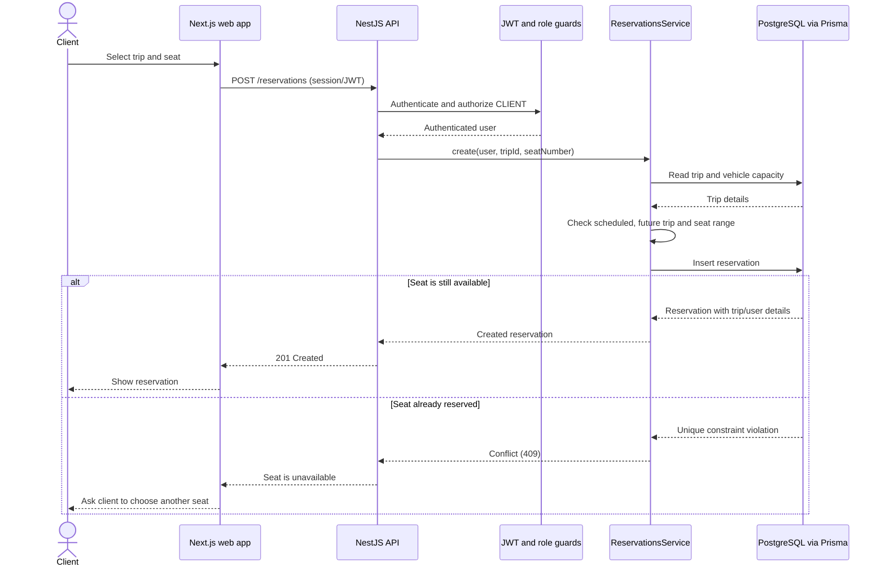
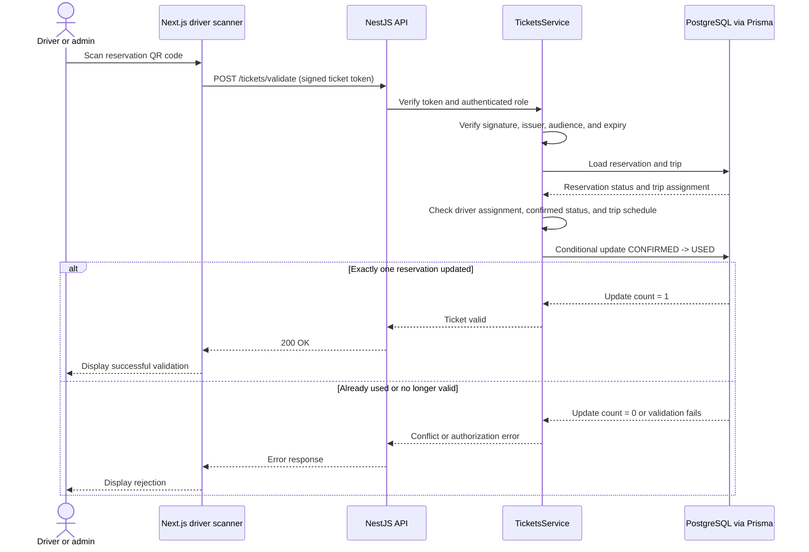

# UML Diagrams

These diagrams describe the current implementation across the Next.js web app, NestJS API, PostgreSQL/Prisma, Redis health check, and local Docker setup. Mermaid diagrams render in GitHub and Mermaid-enabled Markdown previews.

## View the diagrams

In VS Code, open this file and choose **Markdown: Open Preview** (`Ctrl+Shift+V`) or **Markdown: Open Preview to the Side** (`Ctrl+K`, then `V`). GitHub also renders the diagrams when this file is viewed in the repository. If a Markdown preview does not render Mermaid, use a Mermaid-enabled Markdown preview extension.

## Application and deployment architecture

In the documented local setup, Docker Desktop runs PostgreSQL and Redis containers and publishes their ports to Windows. Redis is currently used for the API health check; the application does not use it as a cache or data store.

## Full project component diagram

### API surface by feature

| Feature | Endpoints | Access |
|---|---|---|
| Health | `GET /`, `GET /health` | Public |
| Authentication | `POST /auth/register`, `POST /auth/login`, `GET /auth/me` | Register/login public; profile requires JWT |
| Trips | `GET /trips`, `GET /trips/:id`, `GET /trips/:id/seats` | Public |
| Trip administration | `GET /trips/admin/all`, `POST /trips`, `PATCH /trips/:id`, `DELETE /trips/:id` | Admin |
| Vehicles | `GET /vehicles`, `GET /vehicles/:id`, `POST /vehicles`, `PATCH /vehicles/:id`, `DELETE /vehicles/:id` | Admin |
| Client reservations | `POST /reservations`, `GET /reservations/me`, `PATCH /reservations/:id`, `DELETE /reservations/:id` | Client |
| Reservation administration | `GET /reservations` | Admin |
| Driver reservations | `GET /driver/trips/:tripId/reservations` | Assigned driver |
| QR tickets | `GET /reservations/:id/ticket`, `POST /tickets/validate` | Ticket issue: owner client; validation: assigned driver or admin |
| Reports | `GET /reports/summary` | Admin |

## Use cases

Authorization is enforced by the API: clients manage only their own reservations, drivers can view reservations for trips assigned to them, and administrative operations require the admin role.

## Domain class diagram

The database enforces unique user email, vehicle plate, and `(tripId, seatNumber)` pairs. Each trip references exactly one vehicle; a driver assignment is optional. A reservation belongs to one user and one trip.

## Sequence: reserve a seat

The database's unique `(tripId, seatNumber)` constraint protects against two concurrent requests reserving the same seat.

## Sequence: validate a QR ticket

